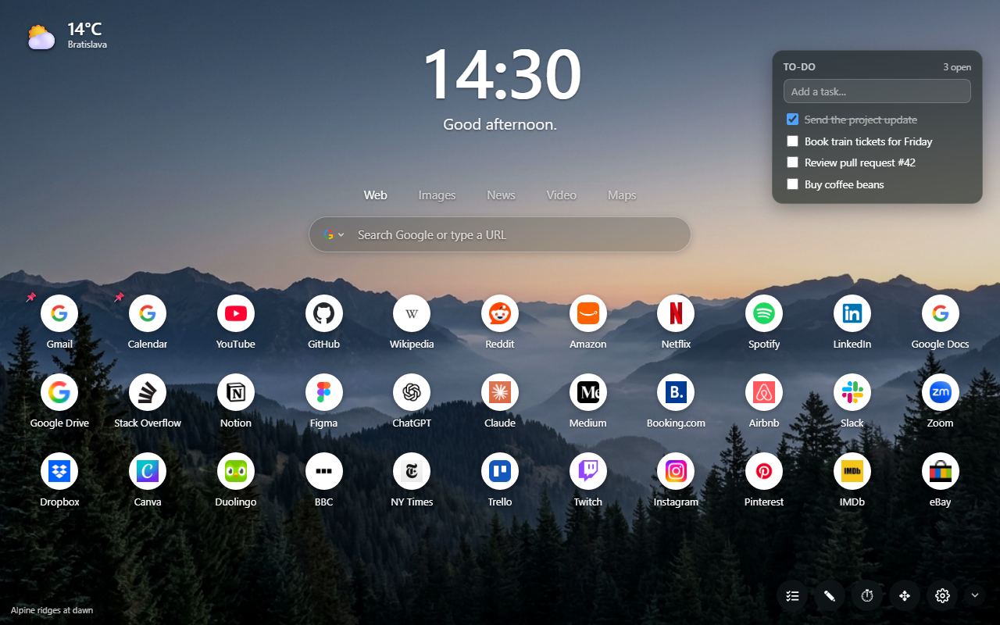
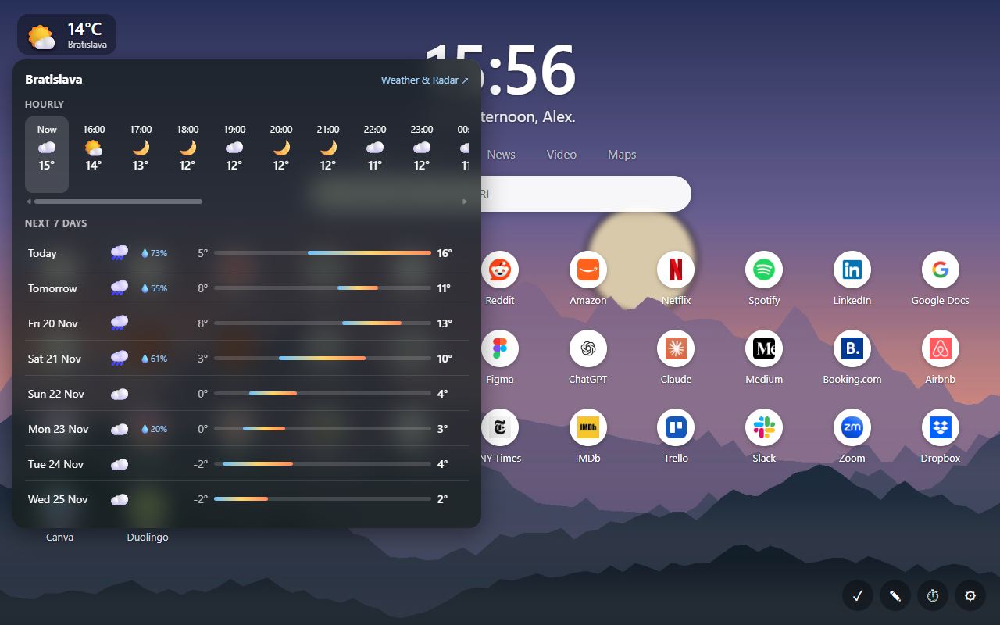
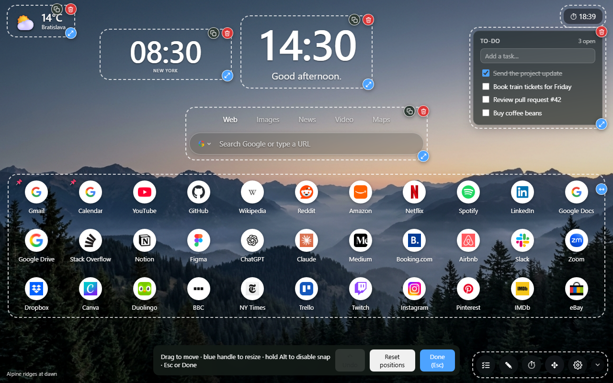
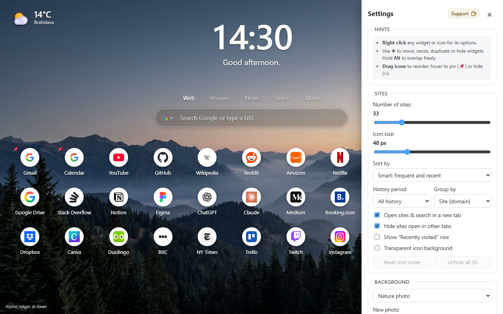

# New Tab – Most Visited

A clean, customizable Chrome new tab page built around the sites you actually use. Automatically builds a grid of your most visited websites from browser history (including imported history), paired with world clock, weather forecasts, Quick Jump search, to-do list, notes, and a focus timer. Completely free — no ads, no account, no paid tier.

**Install from the Chrome Web Store:** https://chromewebstore.google.com/detail/pfbikbofncoonngdodifmipkknigjfin

**Privacy policy:** https://slavomrkva.github.io/newtab-most-visited/

## Install (unpacked)

1. Open `chrome://extensions` and switch on **Developer mode**.
2. Click **Load unpacked** and choose this folder.
3. Open a new tab. If Chrome asks whether to keep the changed new tab page, choose **Keep it**.

After editing files, click ↻ on the extension card in `chrome://extensions`.

## Features

- **Most visited grid**: 8 to 120 sites with real icons, smart recency-weighted ranking, drag-and-drop ordering, pinning, hiding, custom names, optional "Recently visited" row, and transparent icon style.
- **Open-tab awareness**: automatically hides sites that are already open in another tab.
- **Free layout editor (`✥`)**: move, resize, duplicate, or hide widgets with snapping, alignment guides, undo (`Ctrl+Z`), and `Alt` for unrestricted placement.
- **Search & Quick Jump**: 10 selectable search engines, instant switching to open tabs and saved sites as you type, and transparent style.
- **World clock**: 40+ time zones, 4 font styles, optional seconds, date, and greeting, with support for multiple clocks.
- **Weather**: current conditions, hourly (24h/48h), 7-day, and 14-day forecasts, multiple cities, transparent style, and quick link to Weather & Radar.
- **Productivity tools**: pinnable To-do and Notes widgets, Focus timer (25/50-minute sessions and breaks), and a collapsible toolbar.
- **Backgrounds**: daily, hourly, or per-tab nature photos, custom image upload, or 6 gradients, with dimming and blur controls.
- **Sync & backup**: Chrome profile sync plus JSON export and import.

## Screenshots

| Weather forecast | Layout editor & widgets | Settings |
|---|---|---|
|  |  |  |

## Files

| File | Purpose |
|---|---|
| `manifest.json` | Extension manifest (MV3), replaces the new tab page |
| `newtab.html`, `newtab.css`, `newtab.js` | The page |
| `icons/` | Extension icons |
| `store/` | Chrome Web Store package, listing text, privacy policy and images |
| `docs/` | Privacy policy published with GitHub Pages |

## Publishing to the Chrome Web Store

See `store/store-listing.md` for the full submission: listing text, permission
justifications, data disclosures and a checklist.

## Data sources

- Background photos: Bing daily image archive (credited on the page).
- Weather and city search: [Open-Meteo](https://open-meteo.com).
- City name from location: BigDataCloud reverse geocoding.
- Site icons: Google and DuckDuckGo favicon services.
